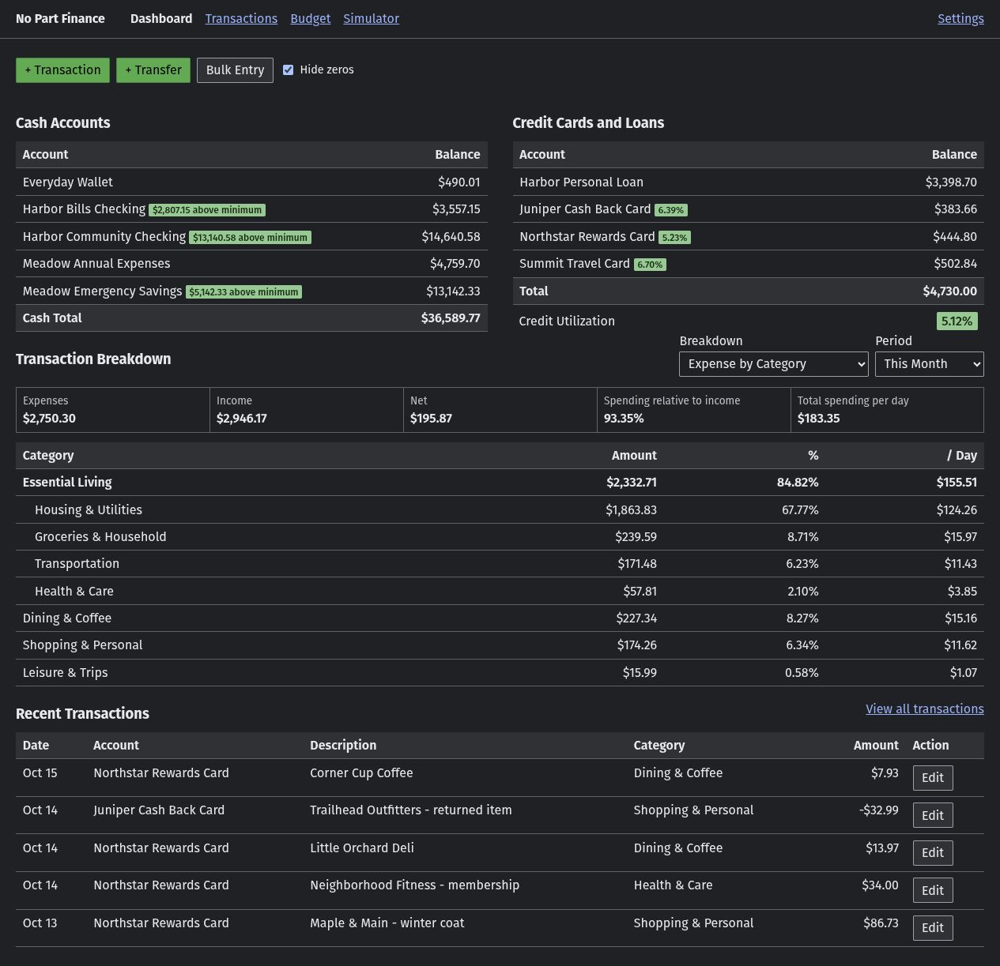
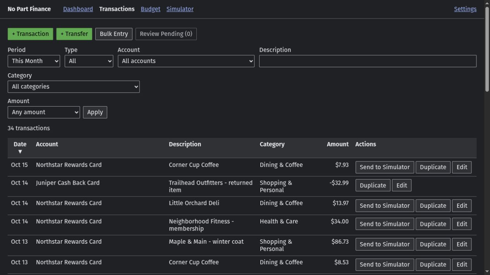
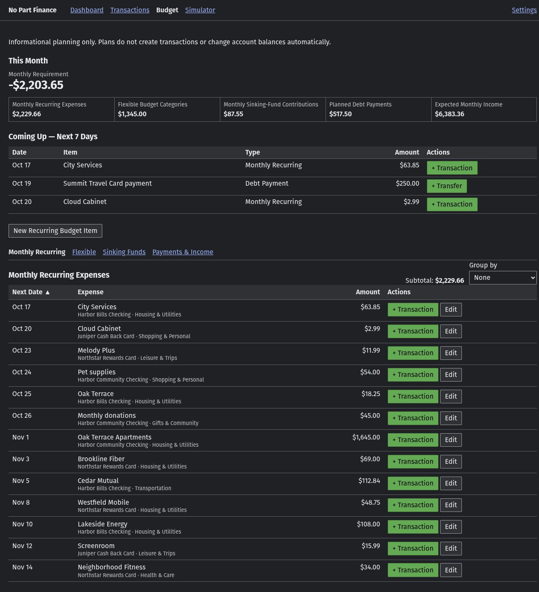
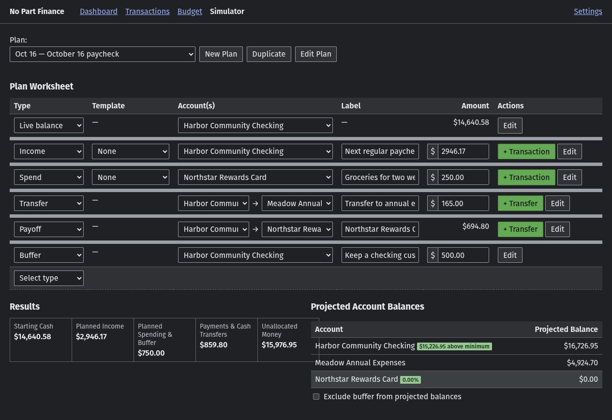

# No Part Finance

A small Flask and SQLite personal finance application with independently provisioned personal ledgers, each with one Owner and multiple read-only Auditors.

## Development status

Version 26.10.21 establishes the multi-ledger database and authorization foundation, per-ledger audit recording, and portable ledger downloads. CLI management can provision additional Owners with separate empty ledgers and multiple Auditors per ledger. Each User has one membership; web account management and household sharing remain future milestones. See [ROADMAP.md](ROADMAP.md) for scope and sequencing.

## License

Copyright (C) 2026 Austin Pritchett.

No Part Finance is licensed under the [GNU General Public License, version 3 only](LICENSE) (`GPL-3.0-only`). See the license for redistribution terms and the disclaimer of warranty.

## Screenshots

All screenshots show AI-generated fictional finances from the included demo database. Account names, employers, merchants, amounts, and planning records are invented; no personal financial records or existing credentials are included.

**Dashboard** — account balances, credit utilization, and category reporting.



**Transactions** — searchable history, refunds, and combined transfers.



**Budget** — recurring expenses, flexible targets, sinking funds, and expected income.



**Simulator** — explore planned spending and transfers without changing the ledger.



## Try the demo

The GitHub source checkout includes `finance.demo.db`, with 740 ledger rows from January 1 through October 15, 2026, including 108 two-row transfers, realistic payroll and spending, refunds, templates, Budget configuration, and three Simulator plans. It is a freshly created fictional database with separate demo users. It contains no copied personal records, original password hashes, or integration secrets. Dates are fixed; select October 2026 or a custom range if the current reporting period is empty. Portable application ZIPs do not include this optional demo fixture.

Keep the supplied fixture unchanged by making a working copy. From the application folder on Linux:

```sh
cp finance.demo.db finance.demo-working.db
FINANCE_DATABASE_PATH="$PWD/finance.demo-working.db" ./startLinux.sh
```

On Windows Command Prompt:

```bat
copy finance.demo.db finance.demo-working.db
set "FINANCE_DATABASE_PATH=%CD%\finance.demo-working.db"
startWindows.bat
```

Stop any existing server first, then open `http://127.0.0.1:5000`. These public credentials work only with the demo fixture:

| Access | Username | Password |
| --- | --- | --- |
| Owner (editable demo) | `demo-owner` | `Demo-Harbor-2026!` |
| Auditor (read only) | `demo-auditor` | `Demo-View-2026!` |

Use the demo only on a trusted local machine or LAN, under the same hosting boundary as the application. Do not use these public passwords for personal finances. Demo edits persist in the working copy; stop the demo before replacing that copy to reset it. Never copy the demo over an existing personal database.

To return to the normal database, stop the demo and run the launcher without `FINANCE_DATABASE_PATH` (Linux: `unset FINANCE_DATABASE_PATH`; Windows: `set "FINANCE_DATABASE_PATH="`). The default remains `finance.db`; the demo does not change normal startup or seed a personal installation.

## Source checkout and private files

After cloning or downloading the repository, run the appropriate launcher described below. Normal startup creates a fresh private `finance.db`; trying the demo requires the explicit database selection above.

`.gitignore` excludes private SQLite databases and sidecars, backups, generated ZIP packages, legacy CSV/TSV exports, virtual environments, caches, local secrets, and editor/Codex artifacts. Only the fictional `finance.demo.db` is deliberately included. Keep real financial information out of source files and screenshots as well as database files. Private database-inclusive packages remain excluded from Git.

## First installation

1. Download the **application-only** ZIP supplied for the release. Its filename contains `-no-db-`. If downloading from an existing installation, use **Settings → System → Application Package → Download application only**. Database-inclusive packages contain private financial data and credentials and are not the public download.
2. Extract the entire ZIP (Windows: **Extract All**) into a new folder you can write to, then open the extracted `No-Part-Finance` folder. Do not run files inside the ZIP or extract over an existing installation for a fresh start. Keep all extracted files together.
3. Install **Python 3.12**, the installation verification baseline. On Windows, use the standard installer from [Python.org](https://www.python.org/downloads/windows/), include pip and the Python launcher, and select **Add Python to PATH**. A per-user installation is sufficient; do not use the embeddable package. See the [Python Windows installation guide](https://docs.python.org/3.12/using/windows.html). On Linux, use your distribution's Python 3.12 installation instructions and include its virtual-environment (`venv`) and pip support; some distributions provide these separately. Python must be available as `python3` or `python`.
4. Run the appropriate start script below. The first run needs internet access to download dependencies. You do not need to activate an environment or install application dependencies manually.

On Windows, double-click `startWindows.bat` or run it from Command Prompt:

```bat
startWindows.bat
```

On Linux, open a terminal in the extracted `No-Part-Finance` folder and run:

```sh
./startLinux.sh
```

If extraction did not preserve executable permissions, run `chmod +x startLinux.sh` once, then retry.

Installation verification used an isolated extracted package on Windows with Python 3.12.14. Linux instructions were checked against the launcher, but Linux startup has not been executed in the current verification environment.

Each launcher runs from its own folder, creates a local `.venv` when needed, checks pip (attempting repair if missing), installs `requirements.txt` there, and starts the application. An existing healthy environment is reused; dependencies are checked on each launch. Application packages are not installed globally.

On a fresh installation, startup creates `finance.db` in the extracted application folder. It starts without user-owned Accounts, Categories, financial history, or default login credentials; the built-in External System Account is not a personal Account. Keep the terminal open while using the application. The server starts before the command-line Owner setup prompt: you can open `http://127.0.0.1:5000` immediately to see configuration instructions. Complete Owner setup in the terminal, then reload the browser to sign in; no server restart is needed.

## Installation troubleshooting

- **Python is not found:** install Python as described above, then reopen the terminal and retry. On Windows, check that the Python launcher or Python is on PATH.
- **Virtual-environment or pip setup fails:** repair the Python installation or install your distribution's venv/pip component, then rerun the start script. Do not delete an existing environment or database as a first troubleshooting step.
- **Dependencies fail to download or install:** read the terminal error, check internet access and the Python installation, then rerun the script. If a double-clicked Windows window closes, run `startWindows.bat` from an already-open Command Prompt to see the error.
- **Files cannot be created:** extract into a folder your user can write to. The launcher needs to create `.venv`, and the application needs to write its database there.

## Direct Python alternative

The start scripts are the normal installation path. If you prefer to manage the environment yourself, these Linux commands perform the same basic setup:

```sh
python3 -m venv .venv
source .venv/bin/activate
python -m pip install --upgrade pip
python -m pip install -r requirements.txt
python app.py
```

On Windows, use `py -3.12 -m venv .venv`, then `.venv\Scripts\python.exe -m pip install -r requirements.txt` and `.venv\Scripts\python.exe app.py` instead. No environment activation is required.

To keep the database elsewhere, provide a platform-appropriate path:

```sh
FINANCE_DATABASE_PATH=/srv/personal-finance/finance.db python app.py
```

## Ledger isolation and portable downloads

Financial records, settings, integration keys, and audit history belong to a ledger. The server resolves ledger access from the signed-in User or integration credential; request IDs cannot select another ledger. Existing records are migrated into one UUID-identified ledger, preserving financial values, IDs, credentials, and history. Its initial name comes from the Owner's username. The application creates a verified pre-migration backup before upgrading; failure stops startup. Users sign in again after restart.

Owner-only **Download Backup** and **Download with database** include only the current ledger, its Owner and optional Auditor, password hashes, integration keys and states, pending submissions, and audit history. They exclude unrelated ledgers and Users, active sessions, and deployment configuration. Downloads are assembled in temporary storage and are not retained in the server's `packages` directory. Store completed downloads securely.

**Disable integration keys in downloaded copy** is unchecked by default. Checking it disables enabled keys only in the downloaded database; their values remain available for later re-enabling. Disabled and revoked keys stay blocked. Live keys are unchanged. Without this option, enabled keys continue to work on both copies. Existing passwords work in the standalone copy, but active browser sessions are never copied.

To run a downloaded copy, stop the destination application and place its database at the configured database path, preserving any old database and sidecars first. Start a compatible application version and sign in again. This is a standalone copy or recovery, not a merge or synchronization with another populated installation. Use the same application and existing trusted hosting arrangement. Command-line database-inclusive packaging and pre-migration backups retain the complete installation database, including all ledgers.

Persistent ledger changes are recorded atomically in append-only audit history with actor identity, time, and relevant before/after values. Passwords, password hashes, integration secret values, and session tokens are excluded from audit content. Logging starts with this feature and does not invent past changes. An audit viewer is a future feature.

## Users and integrations

One **Owner is required** to sign in and use the application. On first startup, type `y` at the command-line setup prompt, choose an Owner username, and enter the same password twice. Passwords must contain 8–128 characters; spaces are allowed and preserved. Typing a password displays no characters, including asterisks. Use an interactive Command Prompt or terminal that supports protected password input. There are no default credentials.

After the Owner is saved, you may create one **optional read-only Auditor**. Press Enter or type `n` to skip it. The saved Owner can sign in even if Auditor setup is skipped, interrupted, or fails.

The server stays available while the setup prompts wait for input. Pressing Enter or declining the initial Owner prompt leaves it running, but sign-in and financial access remain unavailable until an Owner is created. Interrupted or failed input also leaves the server running. Incomplete user creation saves no user; any user whose creation already succeeded remains saved. If no Owner exists, the next normal startup offers Owner setup again.

Manage users only from the command line:

```text
startWindows.bat manage-users
./startLinux.sh manage-users
python app.py manage-users
```

To retry setup, run the appropriate command above from the application folder (Windows: Command Prompt; Linux: terminal). If the server is still running, use a second terminal in the same folder. Choose **Create Owner** if missing, or **Create Auditor** for optional access. Password mismatch or validation errors allow correction through the existing menu; interrupted or unavailable protected input closes it, and you can run the command again. User management is command-line only.

The menu lists/searches Users in pages of 20, creates Owners with separate ledgers, and creates Auditors for an explicitly selected ledger. Select a User to rename them, reset their password with confirmation, or disable/re-enable Auditor ledger access. Users and memberships are retained; no deletion action is offered. Renaming a User leaves the ledger name unchanged. User details also controls administrative Login Enabled/Disabled status independently from Auditor ledger access. Disabling an Owner blocks that ledger's integration authentication while preserving each key's own state; Auditors remain independent. Re-enabling login or access requires fresh sign-in and never enables the other status automatically. Exiting the menu does not start the server. If it is stopped, run `startWindows.bat` or `./startLinux.sh` without `manage-users`. Once the server is running, open `http://127.0.0.1:5000` in your browser and sign in with your configured username and password; if the browser showed incomplete setup, reload it. Keep the server terminal open.

Sign-in records the last successful login in UTC; failed attempts and ordinary session activity do not change it. CLI display comes in a later milestone. Five consecutive failed attempts for a normalized username trigger a five-minute cooldown, alongside the existing per-IP limit. Successful sign-in resets failures; cooldown expires automatically and blocked attempts do not extend it. No permanent account disabling is introduced here.

Sign-in sessions expire 168 hours after login without renewal; logout, password reset, and server restart invalidate them earlier. Settings provides Log Out.

The Owner can create labeled Integration Secrets in Settings → Integrations. Each key belongs permanently to that ledger. Disable/Enable reversibly blocks/restores authentication with the same key; Revoke is permanent. Existing revoked keys remain revoked after upgrade, and proposals remain available for review. Public `/docs` and `/openapi.json` describe authenticated reads, ordinary and transfer/payment proposals, explicit entered signs, retries, and each integration's own status. Bearer integrations can read every current Pending item through GET /api/integration/pending and update one through PUT /api/integration/submissions/{proposalId}, including Manual entries, moved events, other integrations’ proposals, and Owner-edited items. Updates reuse Python validation and existing reviewVersion checks and leave the item Pending; only the Owner approves or rejects. Integrations cannot delete proposals, create Manual entries, move ledger events, update terminal items, or write directly to the ledger. The existing submission-status endpoint retains each integration’s own history.

New Transaction and New Transfer/Payment offer **Save as Pending** alongside normal ledger **Save**. Pending saves close the form and label the proposal **Manual**, preserving the entered Date (including future dates), editable Template prefills, and ordinary Pin. Uncheck **Also log reimbursement** to save a single Pending item. Positive Expense/Income entries use their Category Reporting Role; negative Expense entries are refunds and negative Income entries are reversals. Transfer Amount is always positive and direction comes from From/To Accounts.

The Owner reviews `/pending` in **Transactions** and **Transfers** sections. Dashboard and **Review Pending** show one total plus the kind breakdown; a transfer counts once. Save Row and Enter save corrections while leaving the item Pending; Cancel Changes restores saved values. Selected decisions can mix both kinds and sources. **Approve All Pending** requires every row saved and valid, confirms the total and breakdown, and rejects the entire batch if the queue or reviewed values changed. Check inline validation and any changed Category Reporting Role before approval. Approval atomically records ordinary rows and both zero-sum transfer rows; Pending/Rejected items affect no balances, reports, Budget, or Simulator, and no date automatically approves them.

In a persisted categorized Transaction or valid Transfer/Payment editor, **Move to Pending** captures the saved event as a new Manual proposal and immediately removes its contribution from balances and reports. Save or cancel editor changes first, then review the confirmation. Account balance offsets are unchanged. Uncategorized imported Opening Balance/Balance Adjustment history and invalid transfer pairs cannot move. Original Date and Pin are captured; later review may correct the Date or unavailable references. Rejecting leaves the event out of the ledger. Approval creates new ledger rows, without restoring original IDs. Previously Approved integration proposals retain their own status and retry identity.

Moving also keeps every linked Simulator row and all its saved values, marks it not executed, and clears its ledger link. Those rows affect projections again. Later Pending approval never automatically relinks or executes them. Repeated submissions and moves use durable request identities; a retry does not create duplicate activity.

Account editing offers **Pin in account selectors** for active Cash/Credit Accounts. Operational selectors show eligible pinned Accounts first, alphabetically, without duplicates or a default. Archiving clears the pin; External cannot be pinned. History filters and informational lists ignore pins. Settings shows pin state within its existing Account class tables.

Required-Template Budget creation forms link to Settings Templates. Editing a Recurring Budget Item or Expected Monthly Income adds a direct selected-Template link that briefly highlights its row. Following either link closes the Budget form and discards unsaved changes; it never saves the draft or opens a Template editor automatically.

## Your first transaction

After signing in as Owner:

1. Open **Settings → Accounts → New Account**. Name a Cash Account, such as Example Checking, and enter its current balance as Opening Balance. Leave the optional minimum blank. The starting balance creates no transaction and does not count as Income or Expense.
2. Open **Settings → Categories → New Category**. Create a spending Category, such as Groceries, with Reporting Role **Expense**, and an income Category, such as Paycheck, with Reporting Role **Income**. Parent can remain **None**. These names are examples, not required configuration; the role determines financial meaning and cannot change once the Category has transactions.
3. Return to Dashboard and choose **+ Transaction**. Leave Template as **None**, check the Date (today by default), select the Account, enter a Description, select a Category, and enter a positive Amount for ordinary spending or income. Choose **Save**.

For example, an Example Checking opening balance of `$500.00` followed by a `$12.50` Expense transaction leaves `$487.50` and reports `$12.50` Expenses. Recording `$100.00` with an Income Category then leaves `$587.50` and reports `$100.00` Income. Opening balance is excluded from both totals. Saved Accounts, Categories, and transactions remain after restarting.

One active personal Account and one active selectable Category are enough for ordinary entry; you can add other Categories as needed. Credit Accounts, Templates, reimbursement configuration, Budget, and Simulator are optional. An Auditor can view the setup and recorded activity, but asks the Owner to create or change it.

## Everyday operation

Start an existing installation with `startWindows.bat` on Windows or `./startLinux.sh` on Linux, using the commands under [First installation](#first-installation). Keep the server terminal open. On the host computer, open `http://127.0.0.1:5000` in your browser.

To stop the application, press **Ctrl+C in the server terminal** and wait for the server to exit; Windows may also ask whether to terminate the batch job. Closing the browser does not stop the server. To restart, run the same start script again, reopen or reload the application, and sign in with your existing Owner or Auditor username and password. Saved users and financial data remain in the database, but browser sessions do not survive restart.

The default database is `finance.db` beside `app.py` in the application folder. If `FINANCE_DATABASE_PATH` is set, the application uses that path instead; check the startup terminal's `Database path:` line. Supply the same override whenever starting the application or managing users. Use an absolute path to avoid confusion: a relative override resolves from the start script's folder, or from the current working directory when using direct Python commands. The application creates a new database if the selected file is missing, so confirm the configured path before starting.

### Access from a trusted LAN and deployment boundary

The start scripts run Flask's built-in development server over HTTP on port 5000, bound to all network interfaces (`0.0.0.0`).

On another device connected to the same LAN, open:

```text
http://<computer-lan-ip>:5000
```

Use the LAN address of the computer running the application; do not use `0.0.0.0` in the browser address. Your operating-system firewall may ask you to allow inbound access to port 5000.

Every installation requires an Owner; sign in with your configured Owner or optional read-only Auditor credentials. Use LAN access only on a trusted private network. Remote integrations require HTTPS at your deployment boundary.

The documented arrangement is host-computer or trusted-LAN use. Authentication does not make the built-in development server suitable for direct public internet exposure. Public access requires an external access-control and production-serving arrangement; the supported arrangement and whether separate production-server work is required before public release remain unresolved release decisions. This guide does not configure hosting, HTTPS certificates, or trusted proxies.

## Updating safely

1. While the existing installation is running, create an independent manual backup using [Backup and restore](#backup-and-restore), and save it outside the files you will replace. Retain the previous application files and record the configured database path and any environment overrides or launcher customizations.
2. [Stop the application](#everyday-operation) before replacing files.
3. Extract the new **application-only** ZIP (filename contains `-no-db-`) into a separate folder. Copy the contents of its `No-Part-Finance` folder into the existing application folder, replacing the packaged application files. Do not replace the existing installation folder wholesale or copy a database-inclusive package over it. Preserve the configured database, `.venv`, `backups`, and local configuration. Configuration stored in SQLite stays with the database; environment overrides and deployment configuration are not included in application-only packages. Reapply any intentional launcher customizations after replacement.
4. Run the appropriate start script with the same `FINANCE_DATABASE_PATH` override, if used. The launcher reuses `.venv` and installs the new requirements. Check the terminal for startup errors and the expected database path, then sign in again. Check the application version in **Settings → System**, familiar balances, and transaction history. If an existing installation unexpectedly asks you to create an Owner, stop and check the database path before proceeding.

### Install on desktop or iPhone (online only)

PWA metadata is available for an HTTPS installation served at the domain root. HTTPS remains the reverse proxy's responsibility. The app opens in a standalone window where supported, using the existing Dashboard and Sign In flow. Installation does not replace the running server or network connection. There is no offline Dashboard, queued save, service worker, or background sync.

The four PNG icons are supplied, served publicly, and included in both portable-package variants. Editable SVG sources and export instructions are in `assets/README.md`. Icon dimensions, public responses, and package contents are verified. The user confirmed successful iOS and browser installation on October 18, 2026; browser and operating-system versions were not recorded.

Desktop Chrome users can use the browser's Install control when offered. On iPhone, open the HTTPS app in Safari, choose Share, then Add to Home Screen (and Open as Web App if that option is offered). Names may be truncated by the platform. Other browsers retain ordinary website access and may provide their own installation controls. Localhost can support development checks, but plain HTTP over a LAN is not equivalent to a secure installation.

The launch background is dark (`#202124`); supported browser UI follows the existing Light/Dark/System theme. Platform launch-screen and installation behavior can differ. This feature does not change the trusted self-hosted deployment boundary or provide production hosting.

### Automatic schema upgrades and failures

Startup uses SQLite's schema version to apply required supported upgrades automatically before serving requests. Before upgrading an older compatible database, it checks integrity and creates a consistent SQLite backup in `backups` beside the configured database. The unique filename includes the source version, target version, and timestamp, such as `pre-migration-v19-to-v20-<timestamp>.db`. After migration, startup checks foreign keys, integrity, and the final schema version. New databases and databases already at the current schema receive no migration backup.

If creating or verifying the pre-upgrade snapshot fails, startup stops before migration and leaves the original database unchanged. Incomplete, empty, or invalid snapshots are never used for recovery. If migration or final verification fails after a verified snapshot exists, the application restores that snapshot, retains it, and stops startup. If recovery also fails, the error reports both failures and the verified snapshot path for manual recovery; it does not claim successful restoration. Keep the independent manual backup made before updating.

After an upgrade failure, keep the application stopped, retain the terminal error, and preserve the database and backup files before attempting recovery. Do not assume a failed migration backup is usable or repeatedly restart without resolving the error. Check errors about file permissions or storage, and use a known-good independent backup if recovery is needed; see [Backup and restore](#backup-and-restore).

A database with a schema newer than the application supports is rejected with a `newer than supported` error. Use application files that support that schema. Merely reinstalling older application files does not downgrade an upgraded database, and having a migration backup does not guarantee that the older application can open it. Returning to an earlier installation requires a compatible database snapshot and matching application files; restoring an earlier snapshot loses changes made since it was taken.

## Backup and restore

As Owner, use **Settings → System → Database Backup → Download Backup** while the application is running. It creates a consistent SQLite snapshot using SQLite's supported backup API; do not make a live backup by copying the actively used database file. Save the downloaded `finance-backup-YYYY-MM-DD.db` outside the installation folder and confirm the download completed. An Auditor cannot download database backups.

### Restore an existing installation

1. Locate the configured database using [Everyday operation](#everyday-operation), then stop the application and wait for the server to exit. Do not replace a database while the application is running.
2. Preserve the existing database under a separate name or in a separate location before replacement. Keep any associated SQLite sidecar files with that preserved database if present; do not leave old sidecars beside the replacement. Keep the downloaded backup unchanged as well.
3. Copy the backup to the exact configured database path and filename. For the default configuration, this is `finance.db` beside `app.py`; for `FINANCE_DATABASE_PATH`, use that configured location instead. A downloaded backup's original filename is not automatically selected by startup. Keep the application files and environment configuration in place.
4. Start normally with the same database configuration. Startup applies supported older-schema upgrades and rejects newer unsupported schemas; see [Automatic schema upgrades and failures](#automatic-schema-upgrades-and-failures). If startup fails, keep the server stopped and preserve the files and error before troubleshooting.
5. Reload the browser and sign in using the Owner or Auditor credentials saved in the backup. Browser sessions do not survive restart, and password changes made after the snapshot are undone. Check the startup database path, **Settings → System → Database Status**, familiar balances and transaction history, and, as Owner, pending proposals and Integration Secrets. If Owner setup unexpectedly appears, stop and check the restored file and configured path. Revoke any restored secrets that should no longer have access before resuming integration use.

Restoring replaces the saved installation state with the snapshot and loses changes made after it. Backups contain financial data, user password hashes, recoverable integration secrets, revocation state, and proposal state, including saved review corrections. Treat them as both financial data and credentials. An older backup can reactivate a secret revoked after that snapshot; it must be revoked again. Secrets require no separate encryption key. There is intentionally no restore wizard.

Manual downloaded backups are separate from automatic pre-migration backups in the database's sibling `backups` folder. An application-only ZIP contains application files and no database; it cannot recover financial or credential state. A database-inclusive package contains a consistent database snapshot, but restore only its extracted `finance.db` to the configured database path using the same stopped-application procedure; do not replace application files as part of a database-only recovery. None of these mechanisms schedules automatic backups.

## Portable application package

Create a complete portable snapshot from the repository directory:

```bat
packageWindows.bat --output D:\Packages
packageWindows.bat --no-db --output D:\Packages
```

```sh
./packageLinux.sh --output /srv/packages
./packageLinux.sh --no-db --output /srv/packages
```

Omit `--output` to use `packages`, or run either launcher with `--help` for details. By default, the generated ZIP contains the maintained application, documentation, tests, launchers, and a verified SQLite backup under one `No-Part-Finance` folder. Use `--no-db` for the public application-only ZIP. Both options are available in **Settings → System → Application Package**, through `GET /api/package`, or through `GET /api/package-no-db`, respectively.

Command-line packaging always selects `finance.db` beside `packageApplication.py`; it does not use `FINANCE_DATABASE_PATH`. If your installation uses a database override, use Settings → System → Application Package → Download with database to package that configured database.

On Windows, packaging errors can return exit code 0; check terminal errors and the reported `Archive:` path rather than relying on the exit status.

**Warning:** A default database-included package contains the complete unencrypted financial database and recoverable credentials. Store and transfer it accordingly. A package created with `--no-db` does not contain `finance.db`.

## Release verification — 2026-10-20

Version 26.10.21 full unittest discovery ran 293 tests: 280 passed and 13 were skipped. A final 14-test ledger/security suite also passed, covering migration preservation and late-failure recovery, concurrent Auditor setup, known foreign IDs, database write guards, concurrent request isolation, current access/roles, integration states, audit attribution and rollback, cooldowns, last-login metadata, and standalone exports. All seven JavaScript checks initially skipped for unavailable PATH-based Node passed using the bundled verification runtime; no application dependency was added. The six real-data integration checks remained skipped, and verification used guarded synthetic temporary databases without opening the real financial database.

Browser verification against a temporary synthetic server exercised sign-in, Settings version, integration Disable/Enable presentation, the shared export-only checkbox and both download URLs, and desktop/390px sign-in footer placement without page overflow. Application packages were tested after extraction with temporary startup servers. Live server restart and its verified pre-migration backup are operational deployment steps, separate from these tests.

## Release verification — 2026-10-02

Version 26.10.2 verification used synthetic temporary databases and explicit temporary backup paths. Full unittest discovery ran 258 tests: 252 passed and six source-dependent historical snapshot tests were skipped. The final focused suite passed 22 tests, including forced migration rollback. Checks covered mixed Pending approvals, financial signs, retries and concurrent decisions, ledger moves and Simulator links, permissions/CSRF, schema preservation, documented requests, and packages with and without database fixtures. Narrow-screen browser checks exercised new entry, mixed review, saved corrections, editor safeguards, account selector pins, required-Template links and discarded drafts, and exact Settings version/history. Actual JavaScript handlers separately verified confirmation cancellation and validation guards because the browser tool stalled on native confirmation dialogs. JavaScript syntax checks passed. No real finance.db was initialized, migrated, or written.

Pending API verification at the unchanged version 26.10.2 ran 269 unittest tests: 263 passed and six historical-source tests were skipped. Synthetic temporary database and backup paths covered all-source Pending reads and updates, Owner/API version conflicts, concurrent saves and decisions, signs and zero-sum transfers, immutable retry and moved-event snapshots, pins and Simulator links, validation and rollback, authentication/revocation, restart persistence, published OpenAPI examples and response schemas, and existing packaging/startup behavior. No real finance.db was read, initialized, migrated, or written.

Public Release 6 verification used synthetic temporary databases only. Selected checks covered financial correctness, independent configuration, permissions, integrations, packaging, and startup. Actual application-only archives were inspected for database state and credentials, extracted into an isolated location, and exercised through server, command-line setup, and first-transaction tests with Python 3.12.14.

Browser and computer-use checks were excluded from the final verification scope because of tooling failures. Visual narrow-screen layout and keyboard usability were not verified. Linux startup was not executed. A fresh Windows launcher/dependency-bootstrap attempt did not complete; extracted application checks used the existing Python 3.12.14 environment. These limits are not passing results.

This verification does not declare the release ready for public distribution. The earlier pre-upgrade backup-failure defect is corrected with isolated failure-preservation tests. Public distribution and the production-serving arrangement also remain decisions to make before release.

## Tests

With the virtual environment active:

```sh
python -m unittest discover -s tests -v
```

Tests activate the in-process database guard by importing `tests` before application imports and use explicit temporary database and backup paths. Full discovery includes historical integration tests that may read the real `finance.db` only to create an isolated snapshot. Historical snapshot tests run only when `FINANCE_TEST_SOURCE_DATABASE` explicitly names a source. When a task forbids reading real financial data, leave that variable unset; full discovery skips those source-dependent tests and uses synthetic temporary fixtures. Never initialize, migrate, or write to the real database during testing.

The application has no Node.js build step. `finance.db`, raw legacy CSV data, virtual environments, and bytecode are excluded from version control.
